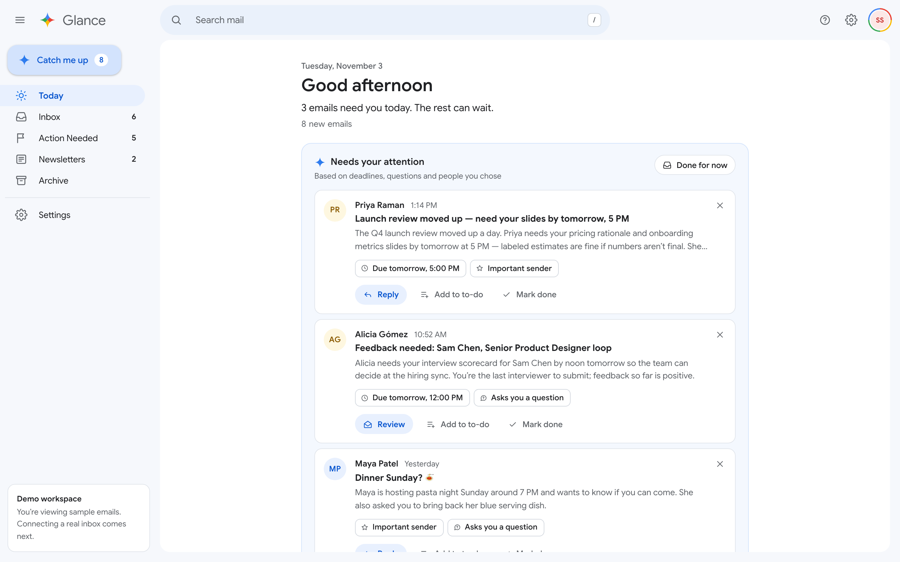
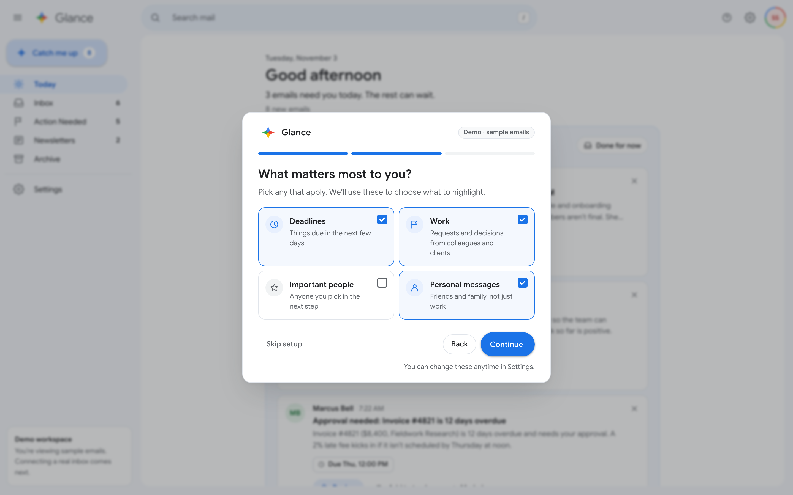
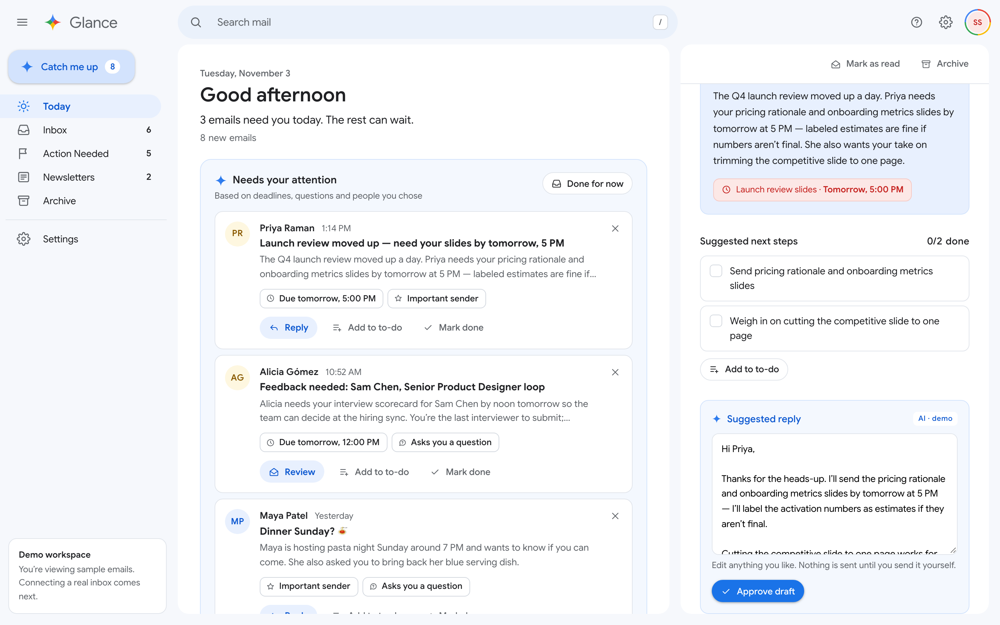
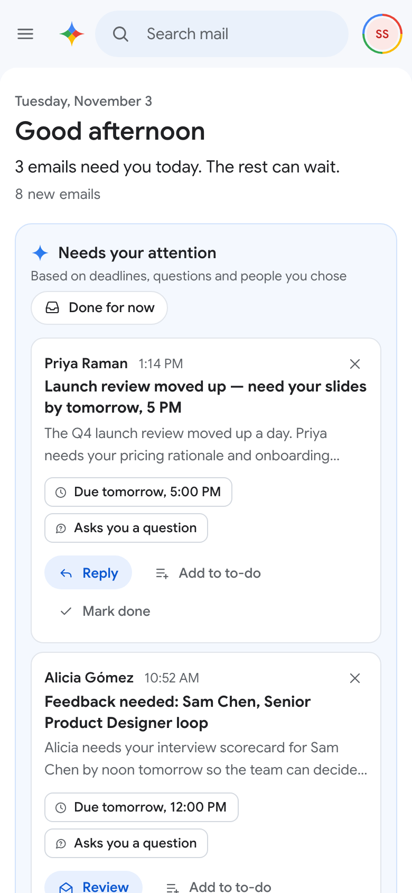
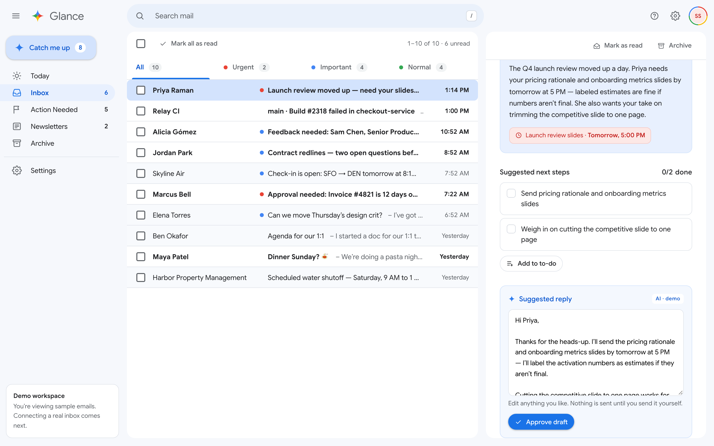

# Glance — an email client that's easy to catch up on

**Live demo: [spriha6.github.io/glance](https://spriha6.github.io/glance/)**

Glance is a concept email client that opens to a calm daily overview instead of a wall of email. It picks the few messages that actually need you, explains why each one was picked, and keeps everything else one click away.

> **Concept project.** Glance uses sample emails and mock AI; no real account is connected and no email is ever sent. Its visual style is inspired by Google's Material Design, but Glance is not affiliated with or endorsed by Google.



## The problem

Inboxes treat every unread email as equally urgent. Important requests — a deadline tomorrow, a direct question from a colleague — get buried under newsletters and notifications, and catching up after time away feels overwhelming.

## Design decisions

- **A short list, not a long one.** "Needs your attention" shows at most three emails. Anything else that qualifies is one link away, so the home screen never becomes another inbox.
- **Always explain why.** Every highlight carries plain-language reasons ("Due tomorrow, 5:00 PM", "Asks you a question", "Important sender"), so the AI's choices are easy to trust or overrule.
- **One clear next step.** Each highlight leads with a single action — *Reply* or *Review* — with *Add to to-do* and *Mark done* as quieter options.
- **The user stays in control.** Suggested replies are editable and must be approved; Glance never sends email. Highlights can be dismissed ("Not now") or hidden for the day ("Done for now"), and every one of those actions can be undone.
- **Calm by default.** Unread counts are shown as quiet text, not alarming badges. Colour is reserved for meaning: blue for AI and selection, red and blue dots for urgent and important email.
- **Familiar where it matters.** The inbox keeps compact, scannable rows, checkboxes, bulk actions and keyboard shortcuts that people already know from desktop email.

## What you can try

1. **Onboarding** — three short, skippable steps: how Glance works, what matters to you (deadlines, work, important people, personal), and who you never want to miss.
2. **Today** — your highlights, your to-dos, and an "Everything else" path into the inbox.
3. **Reply** — open a highlighted email, edit the suggested reply, and approve it.
4. **Done for now** — put today's highlights away and go straight to the inbox; bring them back from *Today* whenever you like.
5. **Inbox** — priority tabs, search (press `/`), select-all, bulk archive and mark-as-read.
6. **Settings** — change your preferences, replay the intro, or reset the demo.

Your choices, to-dos and drafts are saved in your browser, so the demo picks up where you left off.

| Onboarding | Suggested reply | Mobile |
| --- | --- | --- |
|  |  |  |



## Built with

- **React 19 + TypeScript**, built with **Vite**
- Plain CSS with shared design tokens (colour, radius, elevation, layout) — no UI library
- `localStorage` for demo persistence, with safe fallbacks when storage is unavailable
- Accessible by design: semantic landmarks and dialogs, labelled controls, visible keyboard focus, and screen-reader text for colour-only cues
- Deployed to GitHub Pages with GitHub Actions on every push to `main`

How highlights are chosen: [`src/lib/highlights.ts`](src/lib/highlights.ts) scores each open email on a few explainable signals — upcoming deadlines, direct questions, people you marked as important, and the focus areas you picked in onboarding — and keeps the top three.

## Run it locally

Requires Node.js 20.19+ or 22.12+.

```sh
npm install
npm run dev
```

Then open http://localhost:5173. Other scripts: `npm run build`, `npm run lint`, `npm run preview`.

## Author

Designed and built by Spriha Sahni.
